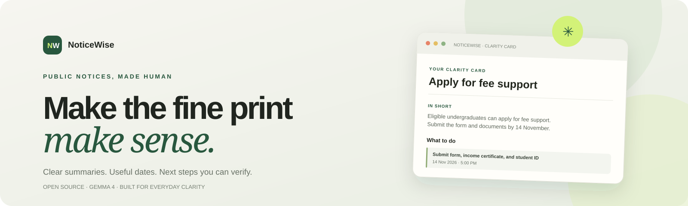
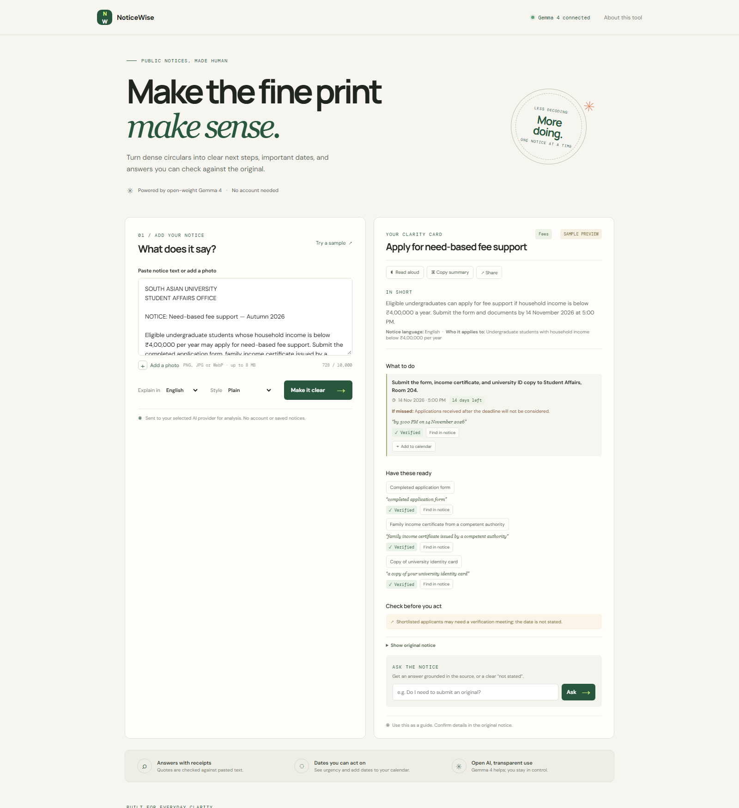
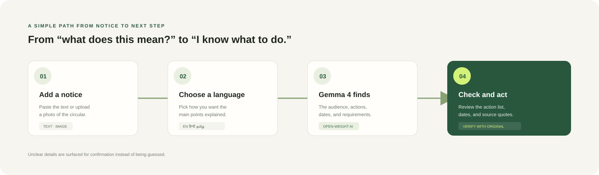
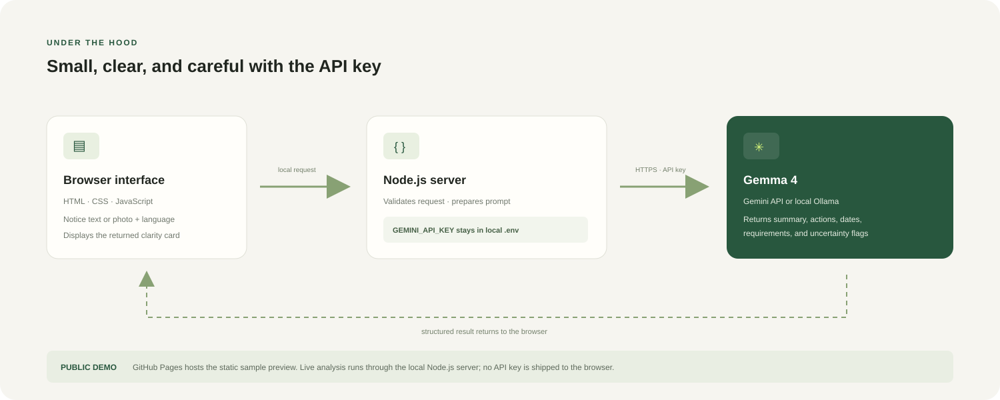

<p align="center">
  
</p>

<p align="center">
  <a href="https://drishya-code.github.io/NoticeWise/?sample=1"><strong>Open the live demo</strong></a> ·
  <a href="https://github.com/Drishya-code/NoticeWise">Source on GitHub</a>
</p>

<p align="center"><sub>The public site is a sample preview. Run locally for live Gemma analysis.</sub></p>

# NoticeWise

**Make the fine print make sense.** NoticeWise turns school, university, and community notices into a plain-language summary, a date-sorted action list, a requirements checklist, and source quotes readers can verify against the original.

Built for **Hacktoberfest Hack Day New Delhi x South Asian University**. NoticeWise is designed for both **Best Use of Gemma 4** and **Best Open-Source AI Project**.

## Product preview

<p align="center"></p>

*Sample content is clearly labeled. The hosted page does not expose an API key; live analysis runs through the local Node.js server.*

## Why NoticeWise

Important opportunities and obligations are often buried in dense circulars, unfamiliar language, and small print. NoticeWise helps people quickly see who a notice applies to, what to do, when to do it, and what still needs confirmation. It flags uncertainty instead of filling gaps with guesses.

## What it does

- Accepts pasted notice text or a photo (PNG, JPG, WebP).
- Creates a concise, plain-language summary and categorizes the notice.
- Extracts actions, dates, requirements, and stated consequences.
- Normalizes deadlines to ISO dates, sorts actions by urgency, and lets readers download calendar events.
- Checks exact evidence quotes against pasted text and lets readers jump to each verified quote in the original.
- Supports grounded follow-up questions; when an answer lacks a verified quote, it says so.
- Explains results in English, Hindi, Bengali, Tamil, Telugu, Marathi, or Urdu, with Urdu rendered right-to-left.
- Includes extra-simple wording, read-aloud, copy, and native share controls.
- Supports Gemma 4 through the Gemini API or a local Gemma model through Ollama.
- Limits API request frequency and never returns provider error details to the browser.

## How it works

### From notice to next step

<p align="center"></p>

### App architecture

<p align="center"></p>

Gemma 4 performs the notice reading and drafting. The server requests schema-shaped JSON, validates the returned fields, and checks evidence quotes before sending the clarity card to the browser. Pasted text and uploaded images are sent to the selected model provider for analysis and are not saved to disk by NoticeWise. See Google's [Gemma API guide](https://ai.google.dev/gemma/docs/core/gemma_on_gemini_api) and Ollama's [structured output guide](https://docs.ollama.com/capabilities/structured-outputs).

## Run locally with Gemini

Requires **Node.js 18+** and a Gemini API key with Gemma 4 access.

1. Copy `.env.example` to `.env`:

   ```powershell
   Copy-Item .env.example .env
   ```

2. Open `.env` and set `GEMINI_API_KEY` to your key. Keep `.env` private; Git ignores it.
3. Start the server and open [http://localhost:8000](http://localhost:8000):

   ```powershell
   node server.js
   ```

Without a key, use **Try a sample** to explore the example card. Live analysis needs a configured provider. Set `GEMMA_MODEL` to another Gemini API Gemma model if needed; the default is `gemma-4-26b-a4b-it`.

## Run with local Gemma through Ollama

Install and start Ollama, then pull a Gemma model that supports image input if you want to analyze notice photos. In `.env`, set the local provider instead of the Gemini key:

```env
AI_PROVIDER=ollama
OLLAMA_URL=http://localhost:11434/api/chat
OLLAMA_MODEL=your-local-gemma-model
```

Use the exact model name shown by `ollama list`. Ollama's local chat endpoint accepts structured JSON output; no Gemini API key is sent in local mode.

## Run in Docker

```sh
docker build -t noticewise .
docker run --rm -p 8000:8080 -e GEMINI_API_KEY=your_key noticewise
```

For DigitalOcean App Platform, select the Dockerfile deployment method and add `GEMINI_API_KEY` as an encrypted app environment variable. The container binds to `0.0.0.0` on port `8080`; the local app defaults to `127.0.0.1:8000`.

## Prize category fit

- **Best Use of Gemma 4:** Gemma 4 reads notice text and photos, extracts actions and dates, simplifies the language, and answers follow-up questions from the source.
- **Best Open-Source AI Project:** NoticeWise is an original, MIT-licensed app built around Google's open-weight Gemma model. It can use the Gemini API or a local Gemma model through Ollama.

## Responsible use

NoticeWise is a reading aid, not an official source or legal or financial advice. Always confirm eligibility, dates, and submission instructions in the original notice. Quote checks reduce unsupported references, but the model can still misunderstand a notice.

## Contributing

See [`CONTRIBUTING.md`](CONTRIBUTING.md) for contribution guidance and beginner-friendly ideas.

## Technology

Node.js built-in HTTP server · HTML · CSS · Vanilla JavaScript · Gemini API · Ollama. No npm packages required.

## License

MIT. See [`LICENSE`](LICENSE).
